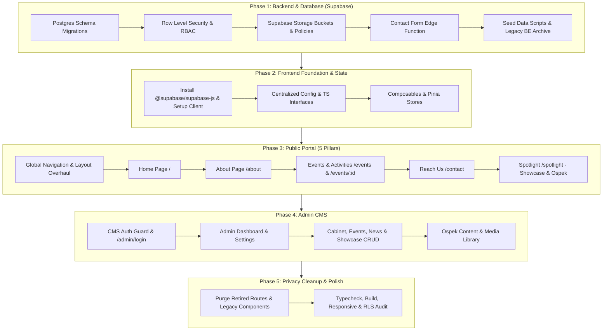

# Implementation Plan: HMPTI UNESA Website Refactor (BE & FE)

> **Status:** Completed (Phases 1-5 Fully Implemented and Verified)

This plan outlines the end-to-end refactoring strategy for the **HMPTI UNESA** website based on [prd.md](file:///d:/Neo_Newie/Projects/web_hmptiunesa/prd.md). It covers transitioning the backend to **Supabase** (Postgres, Auth, RLS, Storage, Edge Functions), retiring legacy Express/MongoDB surfaces and sensitive student/lecturer directories, and overhauling the **Vue 3 / TypeScript** frontend into a modern 5-pillar public portal with an internal Admin CMS.

---

## User Review Required

> [!IMPORTANT]
> **Key Architecture Decisions & Breaking Changes**:
> 1. **Backend Migration to Supabase**: The legacy Express/MongoDB backend is being deprecated and replaced by Supabase (Postgres, Row Level Security, Supabase Auth, Storage, and Edge Functions). Legacy MongoDB data will **not** be migrated or exposed.
> 2. **Navigation & Route Retirement**:
>    - Public routes `/dosen`, `/dosen/:id`, `/anggota`, `/galeri`, `/berita`, `/profil`, `/fungsionaris`, `/kegiatan`, `/projects`, `/login`, `/register`, `/verify-email`, `/user/*` are retired or consolidated.
>    - The new public navbar strictly contains 5 items: **Home** (`/`), **About** (`/about`), **Events & Activities** (`/events`, `/events/:id`), **Reach Us** (`/contact`), and **Spotlight** (`/spotlight`).
> 3. **Dynamic Spotlight**: Switching between `showcase` (student projects) and `ospek` (PKKMB hub) is driven by database settings (`site_settings.spotlight_mode`) and updates live without frontend rebuilds.
> 4. **Contact Form Handling**: Handled via a Supabase Edge Function with honeypot spam protection, rate limiting, and server-side SMTP email dispatch to protect credentials.

---

## Open Questions & Assumptions

> [!NOTE]
> - **Edge Function Mailer**: We assume using a standard SMTP / transactional email service (e.g., Resend or Nodemailer via Edge Function). Please confirm your preferred transactional email provider if specific credentials are ready.
> - **News Model**: Per PRD recommendations, News articles will be supported either as standalone announcements or linked directly to events/activities archive documentation.
> - **Hosting / Domain**: The frontend is built as a portable SPA with relative routing, ready for deployment on Vercel, Netlify, Cloudflare Pages, or traditional static hosting with SPA rewrite rules.

---

## Proposed Changes & Phased Execution



---

### Phase 1: Database & Backend Architecture (Supabase Migration)

#### 1.1 Database Schema (`supabase/migrations/`)
- Create standard Postgres DDL migrations:
  - `profiles`: `id` (references `auth.users`), `full_name`, `role` (`admin` | `editor`), `created_at`, `updated_at`.
  - `site_settings`: Singleton table containing `organization_name`, `cabinet_name`, `cabinet_period`, `tagline`, `logo_url`, `contact_email`, `contact_phone`, `address`, `gmaps_embed_url`, `social_links` (JSONB), `spotlight_mode` (`showcase` | `ospek`), `stats` (JSONB), `updated_at`, `updated_by`.
  - `cabinets`: `id`, `name`, `period`, `vision`, `mission`, `is_active`, `logo_url`, `hero_image_url`, `history_text`, `sort_order`, `created_at`, `updated_at`.
  - `cabinet_departments`: `id`, `cabinet_id`, `name`, `code`, `description`, `icon_url`, `sort_order`, `created_at`.
  - `cabinet_members`: `id`, `cabinet_id`, `department_id`, `name`, `role_title`, `level` (`bph` | `coordinator` | `staff_ahli` | `staff_muda`), `photo_url`, `display_order`, `social_links` (JSONB - public only), `created_at`.
  - `events`: `id`, `title`, `slug`, `category`, `status` (`upcoming` | `ongoing` | `completed`), `start_date`, `end_date`, `location`, `summary`, `description`, `poster_url`, `registration_url`, `contact_person`, `documentation_images` (JSONB/array), `press_release`, `outcome_notes`, `is_published`, `created_at`, `updated_at`.
  - `news`: `id`, `title`, `slug`, `category`, `excerpt`, `content`, `cover_image_url`, `is_published`, `event_id` (nullable reference), `published_at`, `created_at`, `updated_at`.
  - `projects`: `id`, `title`, `slug`, `category`, `description`, `thumbnail_url`, `screenshots` (JSONB/array), `demo_url`, `repo_url`, `contributors` (JSONB - display only), `achievements`, `is_featured`, `is_published`, `created_at`, `updated_at`.
  - `ospek_content`: `id`, `section_type` (`schedule` | `announcement` | `handbook` | `group_info` | `resource_link`), `title`, `description`, `link_url`, `file_url`, `date_time`, `sort_order`, `is_published`, `created_at`, `updated_at`.

#### 1.2 Row Level Security (RLS) & RBAC Policies
- Enable RLS on all tables.
- **Anonymous / Public**: `SELECT` permissions strictly for rows where `is_published = true` (or active settings/cabinets).
- **Authenticated (`editor`)**: `SELECT`, `INSERT`, `UPDATE` on content tables (`events`, `news`, `projects`, `ospek_content`, `cabinet_members`).
- **Authenticated (`admin`)**: Full `SELECT`, `INSERT`, `UPDATE`, `DELETE` on all tables including `site_settings`, `profiles`, and storage configurations.

#### 1.3 Supabase Storage Buckets & Policies
- Buckets:
  - `public-media`: Public read access for logos, event posters, project thumbnails, cabinet member photos, and documentation images.
  - `documents`: Restricted/public download access for Ospek handbooks or public PDFs.
- Policies: Only authenticated users with `admin` or `editor` role can upload/delete. File size limit: 5MB for images, 15MB for documents. Allowed MIME types enforced.

#### 1.4 Supabase Edge Functions
- `contact-submit`:
  - Validates payload (name, email, subject, message).
  - Rate limiting (in-memory or Redis/KV check).
  - Honeypot validation field (rejects bot automated submissions).
  - Sends email to configured organizational email using server-side environment variables.

#### 1.5 Backend Legacy Deprecation
- Create `backend/ARCHIVE_NOTICE.md` documenting the deprecation of Express/Mongoose backend in favor of Supabase.
- Clean up sensitive connection strings from `.env.example`.

---

### Phase 2: Frontend Data Layer & Architecture

#### 2.1 Dependencies & Supabase Client
- Add `@supabase/supabase-js` to `frontend/package.json`.
- Create [frontend/src/lib/supabase.ts](file:///d:/Neo_Newie/Projects/web_hmptiunesa/frontend/src/lib/supabase.ts) initialized with `import.meta.env.VITE_SUPABASE_URL` and `import.meta.env.VITE_SUPABASE_ANON_KEY`.

#### 2.2 Centralized Site Config & TypeScript Definitions
- Create [frontend/src/types/database.ts](file:///d:/Neo_Newie/Projects/web_hmptiunesa/frontend/src/types/database.ts) containing strongly-typed schemas for Supabase entities.
- Create [frontend/src/config/site.ts](file:///d:/Neo_Newie/Projects/web_hmptiunesa/frontend/src/config/site.ts) holding default organization fallback branding, navigation links, and theme definitions.

#### 2.3 Composables & State Management
- [frontend/src/composables/useAuth.ts](file:///d:/Neo_Newie/Projects/web_hmptiunesa/frontend/src/composables/useAuth.ts): Refactor to use `supabase.auth`, tracking user session and profile role (`admin` vs `editor`).
- [frontend/src/composables/useSiteSettings.ts](file:///d:/Neo_Newie/Projects/web_hmptiunesa/frontend/src/composables/useSiteSettings.ts): Load and reactively provide singleton site settings, including `spotlight_mode`.
- [frontend/src/composables/useEvents.ts](file:///d:/Neo_Newie/Projects/web_hmptiunesa/frontend/src/composables/useEvents.ts): Fetch upcoming/ongoing events vs archived documentation.
- [frontend/src/composables/useCabinet.ts](file:///d:/Neo_Newie/Projects/web_hmptiunesa/frontend/src/composables/useCabinet.ts): Fetch active cabinet, departments, and member roster sorted by hierarchy.
- [frontend/src/composables/useProjects.ts](file:///d:/Neo_Newie/Projects/web_hmptiunesa/frontend/src/composables/useProjects.ts): Fetch showcase projects and categories.
- [frontend/src/composables/useOspek.ts](file:///d:/Neo_Newie/Projects/web_hmptiunesa/frontend/src/composables/useOspek.ts): Fetch Ospek schedule, handbooks, and announcements.

---

### Phase 3: Public Portal Overhaul (The 5 Primary Pillars)

#### 3.1 Global Shell & Navigation (`App.vue` & Layouts)
- **Header Navigation**: Exactly 5 links:
  1. `Beranda` (`/`)
  2. `Tentang Kami` (`/about`)
  3. `Kegiatan & Dokumentasi` (`/events`)
  4. `Hubungi Kami` (`/contact`)
  5. `Spotlight` (`/spotlight`)
- Remove all student login/register buttons from the public navbar.
- Modern responsive mobile drawer navigation with smooth animations.
- Premium footer with official HMPTI social links, address, and quick links.

#### 3.2 Home Page ([HomeView.vue](file:///d:/Neo_Newie/Projects/web_hmptiunesa/frontend/src/views/HomeView.vue))
- **Hero Section**: HMPTI branding, active cabinet name & tagline, primary CTAs (`Jelajahi Kegiatan`, `Tentang Kami`, `Spotlight`).
- **Highlights Carousel/Cards**: Up to 3 featured ongoing/upcoming activities.
- **Organization Statistics**: Dynamic counts (departments, completed programs, active committee members).
- **Latest Updates / News Previews**: Cards linking to event documentation and releases.

#### 3.3 About Page ([AboutView.vue](file:///d:/Neo_Newie/Projects/web_hmptiunesa/frontend/src/views/AboutView.vue) - replaces `OrganizationView` & `FungsionarisView`)
- **Story & History**: Journey of HMPTI UNESA.
- **Vision & Mission**: Clear organizational pillars.
- **Active Cabinet Structure**:
  - Filterable by department and hierarchy level (BPH, Coordinators, Staff Ahli, Staff Muda).
  - Public member cards showing approved info only (name, role, photo, public LinkedIn/GitHub links; no NIM/personal data).
- **Department Profiles**: Descriptions, responsibilities, and program focus.
- **Cabinet History**: Archival list of past cabinets and periods.

#### 3.4 Events & Activities ([EventsView.vue](file:///d:/Neo_Newie/Projects/web_hmptiunesa/frontend/src/views/EventsView.vue) & [EventDetailView.vue](file:///d:/Neo_Newie/Projects/web_hmptiunesa/frontend/src/views/EventDetailView.vue))
- Dual view tabs:
  - **Mendatang & Berlangsung (Upcoming / Ongoing)**: Activity posters, dates, venue, registration links, contact person.
  - **Arsip & Dokumentasi (Archive & Documentation)**: Completed activities, outcomes, photo gallery carousels, press releases.
- **Event Detail Page** (`/events/:id`): Shareable URL, dynamic status badge, event rundown/details, media gallery preview, and downloadable public materials.

#### 3.5 Reach Us Page ([ContactView.vue](file:///d:/Neo_Newie/Projects/web_hmptiunesa/frontend/src/views/ContactView.vue))
- Official channels: Instagram, LinkedIn, YouTube, GitHub, TikTok, official email.
- Secretariat address with responsive embedded Google Maps.
- Contact Form: Client-side validation, honeypot spam protection, rate-limit awareness, success/error feedback toasts.

#### 3.6 Spotlight Page ([SpotlightView.vue](file:///d:/Neo_Newie/Projects/web_hmptiunesa/frontend/src/views/SpotlightView.vue))
- Dynamically renders based on `site_settings.spotlight_mode`:
  - **Mode `showcase` (Default)**: Student TI projects, competition achievements, open-source repos, interactive preview modals, tech stack tags, contributor display names.
  - **Mode `ospek` (Seasonal)**: PKKMB/Ospek hub featuring timeline/schedule, guidebooks, task requirements, group allocations, official notices.

---

### Phase 4: Admin CMS Portal Refactoring

#### 4.1 Admin Auth & Navigation Guard
- Dedicated clean login page at `/admin/login` using Supabase Auth.
- Navigation guard ensuring only users with `admin` or `editor` roles can access `/admin/*`.
- Modern admin layout shell with responsive sidebar.

#### 4.2 CMS Modules
- **Site Settings (`/admin/settings`)**: Organization identity, active cabinet selector, contact channels, and the **Spotlight Mode Switcher** (`showcase` vs `ospek`).
- **About & Organization (`/admin/organization`)**: Manage vision, mission, and history copy.
- **Cabinet & Members (`/admin/cabinet`)**: Create/archive cabinet periods, manage departments, add/edit member cards with display order and photo upload.
- **Events & Documentation (`/admin/events`)**: Create, edit, publish/archive events, upload documentation photos, write press releases.
- **News / Releases (`/admin/news`)**: Independent article publication.
- **Showcase Projects (`/admin/projects`)**: Curate student showcase items, links, media, and achievements.
- **Ospek Content (`/admin/ospek`)**: Manage schedule entries, notices, download links, and resource files.
- **Media Library (`/admin/media`)**: Browse, upload, and delete assets in Supabase Storage with size/type validation.
- **CMS Accounts (`/admin/accounts` - Admin only)**: Manage editor accounts and role assignments.

---

### Phase 5: Privacy, Retirement & Cleanup

#### 5.1 Route & Codebase Purge
- **Delete Retired Public Views**:
  - `frontend/src/views/DosenView.vue`
  - `frontend/src/views/DosenDetailView.vue`
  - `frontend/src/views/MemberView.vue`
  - `frontend/src/views/LoginView.vue`
  - `frontend/src/views/RegisterView.vue`
  - `frontend/src/views/VerifyEmailView.vue`
  - `frontend/src/views/user/UserDashboardView.vue`
  - `frontend/src/views/user/UserProfileView.vue`
- **Delete Retired Admin Views**:
  - `frontend/src/views/admin/AdminDosenView.vue`
  - `frontend/src/views/admin/AdminMembersView.vue`
- **Clean Mock Data**:
  - Remove `dosen.json`, `members.json`.
  - Update `events.json`, `projects.json`, `fungsionaris.json`, `organization.json` to match new schemas.
- **Update Router ([frontend/src/router/index.ts](file:///d:/Neo_Newie/Projects/web_hmptiunesa/frontend/src/router/index.ts))**:
  - Direct 404 handler for retired paths.

---

## Verification Plan

### Automated Tests & Quality Checks
```bash
# Frontend type check and build validation
cd frontend
npm run type-check
npm run build
npm run lint
```

### Manual & Functional Verification
1. **Public Information Architecture Check**:
   - Verify navbar contains exactly 5 items: Home, About, Events & Activities, Reach Us, Spotlight.
   - Verify retired routes (`/dosen`, `/anggota`, `/login`, `/register`, `/user/*`) properly 404.
2. **Deep-linking & SPA Routing**:
   - Direct-load `/events/:id`, `/about`, `/contact`, `/spotlight`, `/admin/login` to ensure no routing issues.
3. **Spotlight Mode Switch**:
   - In Admin Settings, toggle between `showcase` and `ospek`.
   - Reload `/spotlight` and verify the UI switches instantly without requiring frontend rebuilds.
4. **Events Dual Tabs**:
   - Test switching between Upcoming/Ongoing and Archive/Documentation.
5. **Contact Form Submission**:
   - Test valid input submission, test honeypot field rejection, test rate limiting.
6. **Responsive UI Review**:
   - Test mobile viewport (360px - 400px), tablet (768px), and desktop (1280px+).
7. **Security & Privacy Audit**:
   - Inspect build bundle for absence of legacy NIM/email fields or service-role keys.
